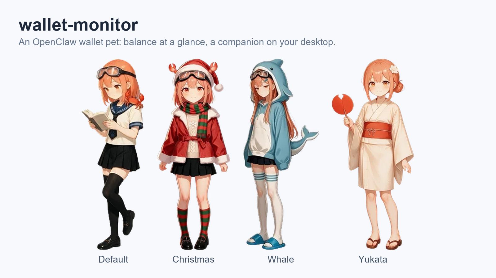
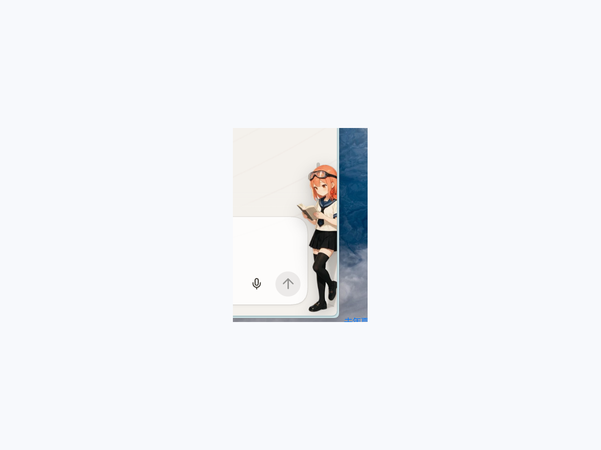
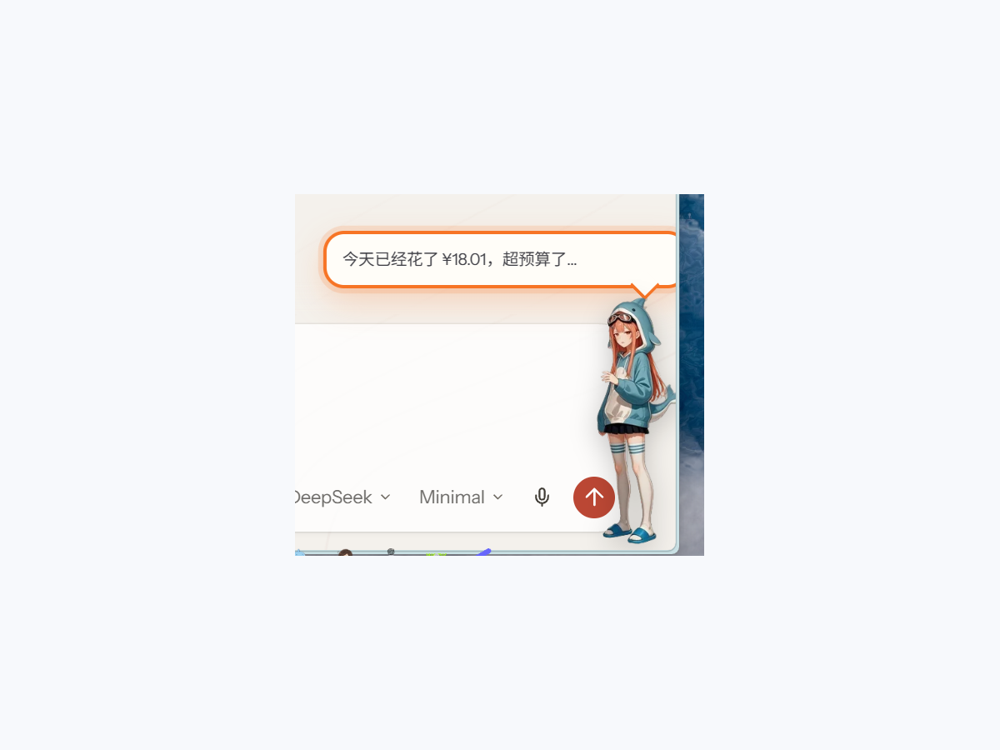
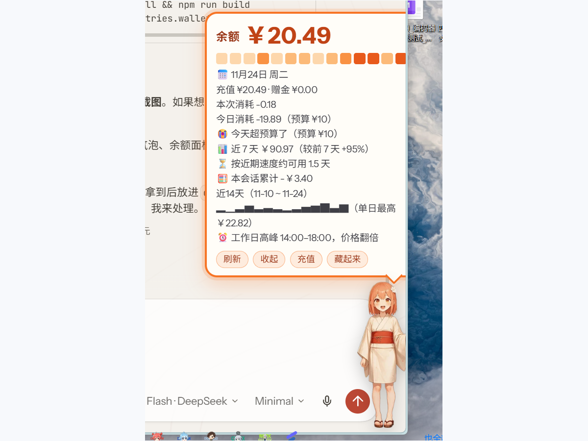
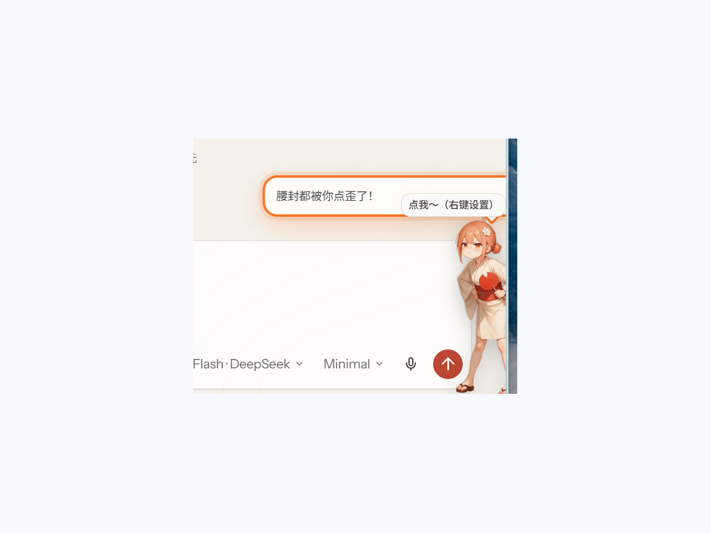
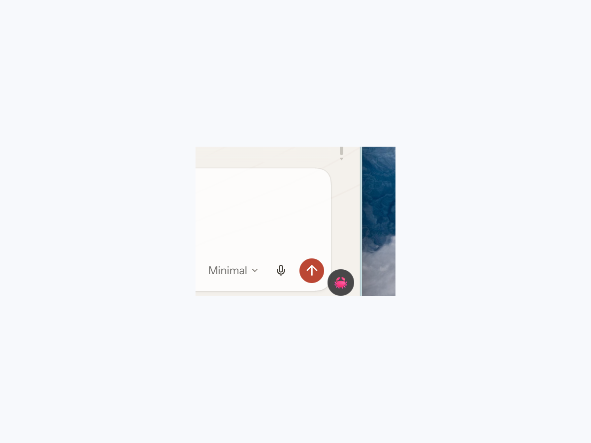
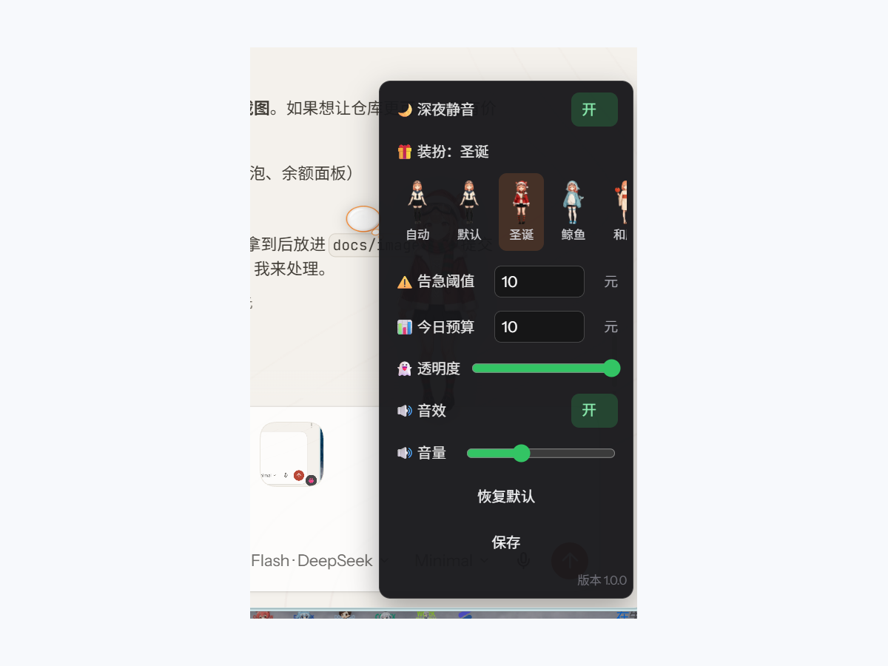

# wallet-monitor

**An OpenClaw wallet pet** — a desktop companion for your OpenClaw Control UI that watches your DeepSeek balance, tells you when you are burning money too fast, and keeps you company while you work.



---

## Screenshots

| | |
|---|---|
|  |  |
|  |  |
|  |  |

## What it is

A Control UI plugin for [OpenClaw](https://github.com/openclaw/openclaw). It puts a small animated character in the corner of your screen:

- **Balance at a glance** — current balance, today's spend, 7-day trend, forecast days left
- **A real companion** — idle animations, reactions to clicks, drag, head-pat, double-click
- **Four outfits** — Default, Christmas, Whale, Yukata, each with its own voice and lines
- **Speaks** — generated TTS lines for interactions, greetings and system events

Everything runs locally. It only talks to the DeepSeek balance API (through your OpenClaw provider config).

## Features

| Area | What you get |
|---|---|
| Balance | live balance, threshold alerts, budget, peak/off-peak pricing note, data freshness |
| Spend | per-run delta, daily total (resets at midnight), 7-day sparkline, "days left" forecast |
| Pet | state machine (idle / talk / busy / think / settle / sleep / cheer / drag …), 20+ poses per skin |
| Interaction | click, drag with edge snapping, double-click dizzy, long-press head pat, hover wave |
| Skins | Default · Christmas · Whale · Yukata, switchable from the settings panel |
| Voice | per-skin timbre, per-action lines, fully local playback |
| Notifications | low balance browser notification, completion chime |

## Requirements

- OpenClaw **2026.10.4** or newer (Control UI plugin API)
- Node.js 20+
- A DeepSeek API key configured in OpenClaw (`models.providers.deepseek.apiKey`)

## Install

```bash
# 1. clone into the extensions directory
cd %USERPROFILE%\.openclaw\extensions
git clone https://github.com/CodeCreaterGugu/wallet-monitor.git

# 2. build
cd wallet-monitor
npm install
npm run build          # or: build.bat  (Windows)

# 3. enable the plugin
openclaw config set plugins.entries.wallet-monitor.enabled true

# 4. restart the gateway, then refresh the Control UI
```

On Windows, `build.bat` wraps the same steps (install → relink → build → prune).

## Configuration

All settings live in the right-click menu on the character, and persist to `state.json`:

| Setting | Meaning |
|---|---|
| `skin` | `auto` / `none` / `christmas` / `whale` / `yukata` |
| `threshold` | low-balance line (¥), default 10 |
| `budget` | daily budget; exceeding it triggers a reminder |
| `sound` | voice on/off |
| `volume` | 0–1 |
| `opacity` | character opacity |
| `quiet` | quiet hours (23:00–08:00) |

## Skins

| Skin | Look | Voice |
|---|---|---|
| Default | black dress, dog-paw tie, green 0/1 code on the hem | MiniMax `female-shaonv` |
| Christmas | red dress, white fur trim, striped socks, a small reindeer "Commit" | Volcengine `tiaopigongzhu` |
| Whale | light-blue shark hoodie, goggles, shark tail, blue slippers | Volcengine `qinglenggaoya` |
| Yukata | pale summer yukata, low bun, paper fan, fireworks | Volcengine `tianmeijiaoqiao` |

Each skin has its own sprite set in `sprites/` and its own line pool in `lines-*.txt`.

## Project layout

```
src/            plugin source (TypeScript)
  crab.ts         the pet: state machine, rendering, interaction
  index.ts        plugin entry: tools, settings, sprite/voice serving
  skins.ts        skin metadata and line pools
sprites/        sprite sheets (webp, 375px canvas)
voice/          generated voice lines (mp3)
lines-*.txt     per-skin dialogue
scripts/        build helpers, TTS generators, sprite importers
docs/           design notes, personas, roadmap
```

## Development

```bash
npm run build      # tsc + openclaw plugins build
npm run validate   # openclaw plugins validate
```

Adding a skin: add a record in `src/skins.ts`, drop sprites as `sprites/{skin}_{pose}.webp` and lines into `lines-{skin}.txt`. The build regenerates the sprite/voice manifests automatically.

## License

MIT — see [LICENSE](LICENSE).

Character art and voice lines are part of this repository and released under the same MIT license.

## Credits

Built on top of [OpenClaw](https://github.com/openclaw/openclaw) plugin APIs. Balance data from the DeepSeek API. Sprites generated with Seedream, voices synthesized with MiniMax and Volcengine TTS.

